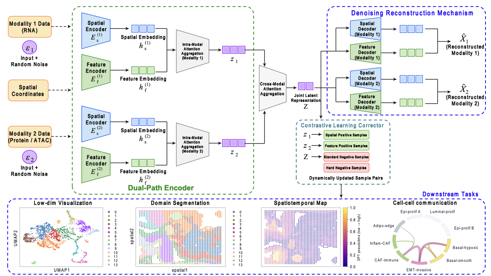

# SPINDE

**A spatial multi-omics integration framework based on a dual-graph attention autoencoder with pairwise contrastive learning.**

SPINDE integrates two molecular modalities measured at matched tissue locations, including RNA–protein and RNA–chromatin accessibility data. It learns a joint embedding for spatial-domain identification and downstream biological analysis.

## Overview



*Figure 1. Overview of the SPINDE framework.* [View the original PDF](Figure.1-Overvie%20of%20SPINDE.pdf).

SPINDE combines four components:

- **Dual-graph encoding:** separate graph convolutional encoders capture spatial neighborhoods and molecular feature neighborhoods within each modality.
- **Attention-based fusion:** attention combines spatial and feature representations within modalities and then integrates the two modalities.
- **Pairwise contrastive learning:** spatial positives, feature positives, sampled negatives, and spatially distant hard negatives constrain embedding relationships.
- **Denoising reconstruction:** corrupted feature inputs are reconstructed against clean targets during training; inference uses clean inputs.

## Installation

The local experiments used Python **3.12.2** and the following Python package versions:

| Package | Version |
|---|---|
| PyTorch | `2.4.0+cu121` |
| NumPy | `1.26.4` |
| SciPy | `1.13.1` |
| pandas | `2.2.3` |
| AnnData | `0.9.2` |
| Scanpy | `1.9.3` |
| scikit-learn | `1.4.2` |
| scikit-misc | `0.5.1` |
| h5py | `3.11.0` |
| Numba | `0.59.1` |
| umap-learn | `0.5.7` |
| Matplotlib | `3.8.4` |
| seaborn | `0.13.2` |
| tqdm | `4.66.4` |
| igraph | `0.11.5` |
| leidenalg | `0.10.2` |

The PyTorch build uses CUDA **12.1**. Install a PyTorch build appropriate for your machine using the [PyTorch installation instructions](https://pytorch.org/get-started/locally/), then install the remaining packages:

```bash
python -m pip install numpy==1.26.4 scipy==1.13.1 pandas==2.2.3 \
    anndata==0.9.2 scanpy==1.9.3 scikit-learn==1.4.2 scikit-misc==0.5.1 \
    h5py==3.11.0 numba==0.59.1 umap-learn==0.5.7 matplotlib==3.8.4 \
    seaborn==0.13.2 tqdm==4.66.4 igraph==0.11.5 leidenalg==0.10.2
```

NumPy `1.26.4` was supplied through the process-local compatibility environment during the experiments. Optional backends used `louvain==0.8.2` and `rpy2==3.4.1`; the R `mclust` backend also requires R and its `mclust` package. The `mclust_python` backend does not require R.

